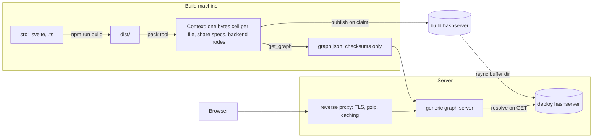

# Preparic on Seamless

Analysis · 15 October 2026

How to develop the preparic Vite + Svelte app against a Seamless share server while keeping Vite's compiling and hot reloading. Then how to deploy it as a Context graph whose bytes live on a hashserver, served by a generic graph server.

*Design only: nothing here has been run against preparic*

*Sources: shares contract, share server code, hashserver README, ~/preparic*

**Contents**

- [Summary](#summary)
- [Preparic today](#preparic-today)
- [Compared with serve.py](#compared-with-share-slidersservepy)
- [Development](#development-vite-in-front-share-server-behind)
- [Deployment](#deployment-graph-hashserver-generic-server)
- [Decisions and open checks](#decisions-and-open-checks)

## Summary

### Development

Put Vite in front and the share server behind it. `npm run dev` keeps compiling and hot reloading. Vite proxies the share namespace (REST and websocket) and `/seamless-client.js` to the share server on 127.0.0.1:5813. The Python Context runs in Jupyter and is edited live. The share server cannot do hot reloading itself: it serves stored bytes and cannot proxy.

### Deployment: your preferred path works with today's contract

Compile offline, then pack `dist/` into a Context with one `bytes` cell per file, each shared at its path. The Context publishes the buffers to the hashserver and `get_graph()` writes a graph that holds only checksums. A generic server loads any such graph with `set_graph(graph, mounts=False, shares=True)` under a namespace given on its command line. No share-server change is needed. The server needs no Node and no app-specific code.

Five things make it work:

1. `base: './'` in Vite, so the page works under `/<namespace>/`. Top-level share paths can't have more than one segment.
2. `bytes` cells with the content type pinned at pack time, so each file is served exactly as built.
3. The server always loads graphs with mounts stripped.
4. A startup check that every checksum is on the hashserver. Otherwise a missing buffer first shows up as a 503 in a browser.
5. A reverse proxy in front, for TLS, compression and long-lived caching. The share server has none of the three.

### What it gives you

A release is identified by one graph checksum. Rollback means pointing at the previous checksum. Files that didn't change are never uploaded again. The static app and a future Python backend ship as the same kind of artifact.

### Decisions owed

Five decisions are open; see [Decisions and open checks](#decisions-and-open-checks). In short:

- Where the server lives and what it's called.
- Whether the namespace redirect should keep the query string.
- One shared Context or one per user, once preparic has a backend.
- Whether the server saves live graphs.
- Whether folder shares should become a feature.

## Preparic today

*Summarized by a Sonnet subagent from a read-only pass over ~/preparic, lightly condensed.*

- **What it is.** A browser-only Svelte 5 single-page app, "Phase 1" of a molecular-selection tool. `index.html` loads `/src/main.ts`, which mounts `App.svelte`. Components are in `src/components/` (Stage1Structure, Stage2Ranges, RangeTable, Viewer). App state lives in `src/lib/state.svelte.ts`, with molstar code in `src/lib/molstar/`.
- **Tooling.** `vite.config.ts` contains only `plugins: [svelte()]`. TypeScript is strict with `noEmit`. It uses Vite 6 and pins molstar 5.13.1. The npm scripts are `dev`, `build`, `check` and `test`. A conda env `preparic` provides Node 22.
- **Development.** Plain `npm run dev` with Vite's defaults: no port, proxy or hot-reload configuration.
- **Build.** Output goes to `dist/` with base `/`. File names carry content hashes (`/assets/index-*.js`). `Viewer.svelte` loads molstar on demand, which becomes a separate ~3 MB `viewer-*.js` file.
- **Deployment.** None. There is no Dockerfile, nginx config, CI, backend, `fetch`, websocket or `VITE_*` variable. The browser only calls models.rcsb.org (`.bcif` files) and Google Fonts. The phase docs say a server comes later. Nothing refers to Seamless.

## Compared with `share-sliders/serve.py`

|  | serve.py | preparic |
| --- | --- | --- |
| Page source | One hand-written `index.html` that loads the client with a plain `<script>` tag | Svelte + TypeScript, which must be compiled |
| Files served | 1: a `text` cell mounted with `mode="r"`, shared at the top level | `index.html` plus hashed files under `/assets/`, including the 3 MB viewer file |
| After an edit | New bytes are served within about 0.2 s (the mount poll interval), but the browser is not told; you reload by hand | Vite hot-swaps the changed module |
| Backend | A Context with writable `a`/`b` and computed `c` | None yet |

Serving preparic's `dist/` the way `serve.py` serves its page runs into five limits:

1. **One cell per file.** Folder cells can't be shared, so every file needs its own cell and share.
2. **Top-level share paths have a single segment.** `/assets/x.js` under base `/` can't be served. Paths inside a namespace can have several segments, so `base: './'` with each file shared at its `dist/`-relative path works: `/preparic/index.html`, `/preparic/assets/…`.
3. **Hashed names change on every build.** With file mounts this means the set of shares keeps changing. (This does not matter when each build produces a new graph; see [Deployment](#deployment-graph-hashserver-generic-server).)
4. **The browser client never reports changes to file-like shares.** Shares whose name contains a `.` aren't fetched automatically, and `onchange` is only called after a fetch (`seamless-client.js:163,373`). A rebuilt file can't trigger a reload by itself.
5. **The redirect from `/` or `/<ns>/` to `index.html` drops the query string** (`server.py:711,716`). Links like `?pdb=1B7F&continue=1` must point at `…/index.html?pdb=…` directly. GET requests ignore unknown query parameters.

## Development: Vite in front, share server behind

Hot reloading needs Vite's dev server, which compiles modules on request and pushes updates over its own websocket. The share server only serves stored bytes and can't proxy, so Vite has to be the front door during development.

### Inner loop (daily work)

Run the Context in Jupyter or `python -i backend.py`, bound to 127.0.0.1 like `serve.py` does, with `ctx.shares.namespace = "preparic"`. Run `npm run dev` alongside it.

**vite.config.ts**

```ts
export default defineConfig({
  base: './',
  plugins: [svelte()],
  server: { proxy: {
    '/preparic':          { target: 'http://127.0.0.1:5813', ws: true },
    '/seamless-client.js': 'http://127.0.0.1:5813',
  }},
})
```

- **Page setup.** Add `<script src="/seamless-client.js"></script>` to `index.html`; Vite leaves non-module scripts alone. Call `connect_seamless(null, null, "preparic")` once, from a small `src/lib/seamless.svelte.ts` wrapper that turns shared cells into reactive Svelte state. Keep that call in its own module, so hot-swapping a component doesn't run it again and open a second websocket.
- **Why a proxy.** Same-origin requests keep the frontend code identical in development and production. CORS is open, so `connect_seamless(5813)` would also work, but it builds the port into the code.
- **Why a separate namespace.** Vite matches proxy paths by prefix, so a distinct name like `preparic` avoids catching app routes.
- **What happens on an edit.** `.svelte`, `.ts` or `.css`: Vite hot-swaps it and component state is kept. `index.html`: Vite reloads the page. Python: change a cell or transformer in the live Context; it recomputes, pushes an update over the websocket, and the wrapper re-renders. Neither side restarts.
- **Bonus.** State you move into writable shared cells (the PDB id, the ranges) survives full reloads, and Python can see it.

### Smoke test of the built app (optional)

To check the built app while still developing, have a script mount each `dist/` file as a cell with `mode="r"` and share it at its relative path. Run `vite build --watch` next to it.

- **Turn hashing off here.** Set `entryFileNames`, `chunkFileNames` and `assetFileNames` to `[name]` patterns, so rebuilds update the mounted cells in place. If a rebuild briefly deletes or truncates a file, the share keeps serving the last good value.
- **Auto-reload, if wanted.** Add one share without a dot in its name (e.g. `buildstamp`, written by a small `closeBundle` plugin). The page calls `location.reload()` when it changes, debounced.
- **Limits.** There's no hot reloading, and every rebuild re-bundles the 3 MB viewer file. This checks the built form; it doesn't replace the inner loop.

### Not recommended: compiling inside Seamless

Running `vite build` as a bash transformer puts the sources plus `node_modules` into the cache key. You'd lose hot reloading and pay a full build on every save, to cache a step that takes seconds. That fits your plan: compile offline and let the graph record only the result.

## Deployment: graph, hashserver, generic server

> The path works with today's share contract and needs no share-server change. The app's own code is used only at build time. At deploy time, a generic server loads a graph and a hashserver supplies the bytes.



### Build: compile offline, pack into a Context

Change the Vite config in one place: `base: './'`. The page then loads its assets relative to wherever `index.html` is served, so the same build works under any namespace. Keep Vite's content hashes for deployment builds. Each build makes a new graph, so the changing names cost nothing, and they let the reverse proxy mark assets as immutable (see [Request path](#request-path-and-performance)).

The pack tool is generic. It walks `dist/`, makes one cell per file, shares it at its relative path, and writes the graph. If preparic gains a backend, the tool first calls the app's builder function, like `build()` in `serve.py`, so static files and backend nodes end up in one graph.

**pack_dist.py (sketch, untested)**

```python
import json, mimetypes
from pathlib import Path

import seamless, seamless.config
from seamless import Cell
from seamless_workflow import Context, shareserver

NULL_CONTENTS = (b"", b"null\n", b"null")   # these get the null checksum; the share would answer 204

def node_name(rel):
    # "assets/index-DD5wxIS0.js" -> "web__assets__index_DD5wxIS0_js"
    return "web__" + "".join(c if c.isalnum() else "_" for c in rel.replace("/", "__"))

def pack(dist, graph_out, backend=None):
    seamless.config.init()                            # build stage: a writable hashserver
    shareserver.configure(host="127.0.0.1", port=0)   # share() records specs; nothing is exposed
    ctx = Context()
    try:
        if backend is not None:
            backend(ctx)                              # the app's own nodes
        names = set()
        for f in sorted(Path(dist).rglob("*")):
            if not f.is_file():
                continue
            rel = f.relative_to(dist).as_posix()
            data = f.read_bytes()
            if data in NULL_CONTENTS:
                raise ValueError(f"{rel}: content would be served as null (204)")
            name = node_name(rel)
            if name in names:
                raise ValueError(f"{rel}: node name collision")
            names.add(name)
            mimetype = mimetypes.guess_type(rel)[0] or "application/octet-stream"
            setattr(ctx, name, Cell(celltype="bytes"))
            cell = getattr(ctx, name)
            cell.set(data)
            cell.share(path=rel, mimetype=mimetype)   # pinned into the graph's share entry
        graph = ctx.get_graph()
    finally:
        ctx.close()
        seamless.close()                              # flushes pending hashserver writes
    Path(graph_out).write_text(json.dumps(graph, indent=1, sort_keys=True))
```

- **Publishing is automatic.** A non-scratch Context cell publishes its literal to the hashserver when the Context claims it. `seamless.close()` flushes pending writes and reports any buffers it couldn't write; treat that as a failed build.
- **Verify after packing.** Batch-check every checksum against the hashserver's `GET /has-now`. For `bytes` cells there is also a cross-check: each checksum equals `sha256sum` of the file.
- **Calling `share()` at build time** starts the share server briefly on a loopback port. It's the simplest way to get valid format-0.6 share entries without writing graph JSON by hand.
- **Generated node names** avoid the question of whether a Context node may be called `index.html`. The share path carries the real name.

### Celltype and content type

- **Use `bytes` for every file.** It is the one celltype whose buffer is the file as-is, with no canonical re-serialization. The served body is therefore the built file byte for byte. `text` would also work for UTF-8 files, but adds a decode and canonicalization step for no gain.
- **Watch for null contents.** An empty file, or a file containing exactly `null\n` (or `null`), maps to the null checksum and is served as `204` with no body. The pack tool refuses these files.
- **Pin the content type at pack time.** Without an explicit `mimetype`, the server guesses from the extension with Python's `mimetypes`, which depends on the Python version and the host's `mime.types`. Browsers refuse module scripts that aren't served with a JavaScript MIME type, so the guess must not be left to the deploy machine. The share entry stores the pinned value in the graph. `charset=utf-8` is still added to `text/*` types.

### Hashserver

|  | Build side | Deploy side |
| --- | --- | --- |
| Mode | Writable (`--writable`) | Read-only (the default) when the graph has no writable shares and no transformers, as for preparic Phase 1. Writable once PUT values or computed results must survive. |
| Contents | Every buffer the Context published | A copy: the buffer directory is plain files named by checksum, so `rsync` transfers only what's new |
| Reachability | Build machine or CI only | The graph server only; never public |

- **Deduplication.** The 3 MB viewer file is uploaded once and transferred again only when molstar or the viewer code changes.
- **Check at startup.** Before loading, the server batch-checks every checksum in the graph with `GET /has-now`. Unlike `/has`, it doesn't count buffers that are only promised. Without this check, a missing buffer first shows up as a `503` on a browser's request.
- **Unverified:** whether a Context with a read-only hashserver tries to publish the literals it fetches. Declare the hashserver read-only in the deployment `seamless.yaml` and check for write attempts in its log.

### The generic graph server

The server does nothing app-specific. Everything it needs is in the graph, the deployment `seamless.yaml` and its command line. The share namespace is runtime state rather than part of the graph, so it comes from the command line too.

| Concern | Behaviour |
| --- | --- |
| Configuration | `seamless.config.init()` from a deployment `seamless.yaml`: the hashserver, an optional database, and the execution backend for transformers |
| Input | A graph file, or a graph checksum resolved from the hashserver as a `plain` buffer |
| Loading | `ctx.set_graph(graph, mounts=False, shares=True)`. Mounts are always stripped: a server must never read or write files because a graph says so. |
| Startup check | `/has-now` on every checksum in the graph; refuse to start if any is missing. Optionally resolve each shared buffer once to warm the local cache. |
| Binding | 127.0.0.1 by default. The share server has no authentication and no TLS. |
| Several apps | One Context per graph, each under its own namespace, all on one port |
| Live state | Optional: save `get_graph()` periodically when the graph has writable shares, and resume from it after a restart (old Seamless's server did this) |
| Shutdown | SIGTERM or SIGINT: `ctx.close()`, then `seamless.close()` |
| Health | No dedicated endpoint; `GET /openapi.json` answers whenever the server runs |

**Command line (sketch)**

```bash
seamless-serve-graph --graph preparic=graph.json \
                     [--graph other=<graph checksum> ...] \
                     --host 127.0.0.1 --port 5813 \
                     [--snapshot-dir state/ --snapshot-every 10s]
```

**Core (sketch, untested)**

```python
import signal, threading
import seamless, seamless.config
from seamless_workflow import Context, shareserver

def serve(graphs, host="127.0.0.1", port=5813):
    seamless.config.init()
    shareserver.configure(host=host, port=port)
    contexts = []
    try:
        for namespace, graph in graphs.items():
            preflight(graph)                  # /has-now on every checksum in the graph
            ctx = Context()
            contexts.append(ctx)
            ctx.shares.namespace = namespace
            ctx.set_graph(graph, mounts=False, shares=True)
        stop = threading.Event()
        for sig in (signal.SIGTERM, signal.SIGINT):
            signal.signal(sig, lambda *_: stop.set())
        while not stop.wait(1.0):
            pass
    finally:
        for ctx in contexts:
            ctx.close()
        seamless.close()
```

### Request path and performance

A browser GET for `/preparic/assets/viewer-*.js` works like this. The share's record names a checksum, and the server resolves it from its local buffer cache, falling back to the hashserver. It then sends the whole body. The first request for each checksum goes to the hashserver; later ones come from the local cache until eviction.

The share server leaves out three things a static site normally gets:

- **No compression.** The 3 MB viewer file goes out uncompressed. JavaScript usually shrinks severalfold with gzip or brotli.
- **Revalidation on every load.** Every response carries `Cache-Control: no-cache` with the checksum as `ETag`. Each page load revalidates every file, and unchanged files cost only a `304`.
- **No range requests, and no TLS.**

A reverse proxy (nginx or Caddy) supplies all three:

- It compresses responses.
- It terminates TLS.
- It sets `Cache-Control: public, max-age=31536000, immutable` on `/<ns>/assets/*`. That is only safe because the deployment build keeps Vite's content hashes.
- It can redirect `/` to `/preparic/`, so no top-level share is needed.

### What the server exposes

- **Every share, to anyone who reaches the port.** Bind to loopback and put access control in the proxy.
- **`/<ns>/state-graph` and `/openapi.json`, always.** Once a Context has a share, its whole node state graph is served: every node's path, celltype, state, checksum and error text. This is harmless for static cells. For a backend, block the path at the proxy if it shouldn't be public.
- **Writable shares are shared by all visitors.** Everyone writes the same cell (see below).
- **Loading a graph opens endpoints and may run transformer code.** The server should load only graphs you built, named by checksum in its deployment config.

### One Context, or one per user

Preparic Phase 1 keeps all its state in the browser, so the deployment graph holds only static cells and nobody shares state. Once a backend arrives, one Context means one shared state for every visitor. A molecular-selection tool is probably per-user. The pattern that fits:

- The static graph is loaded once at a fixed namespace (`/preparic/`).
- Each session gets its own backend Context, built from a template graph, at `/s-<id>/`. The page reads the session id from its URL and calls `connect_seamless(null, null, "s-" + id)`.
- The share server has no custom routes. Creating sessions therefore needs a small control listener in the generic server, behind the proxy. Sessions also need idle expiry, and optionally resume from a saved graph. Old Seamless's Cloudless did this with `/instances/<id>/`.
- Sessions share the static buffers, because the checksums are the same. Each session costs only its backend.

### Releases, rollback and provenance

- **A release is a graph checksum.** Store `graph.json` on the hashserver as a buffer and name its checksum in the deployment config. Rolling back means naming the previous checksum. Its buffers are still there unless the hashserver was cleared.
- **Swapping without a restart is possible.** `ctx.set_graph(new_graph)` on the live Context replaces everything, and markers continue per URL. Open pages still need a reload.
- **The compile step is outside Seamless identity.** The graph records what was built, not how. Record the "how" as a cell: `ctx.build_info` (git commit, `package-lock.json` checksum, exact Node version), shared read-only as `build-info`. The page can show it in its footer.
- **Byte-identical rebuilds** need an exact Node pin (the conda env pins only `nodejs=22`) and `npm ci`.

### Against the alternatives

| Path | Gains | Costs |
| --- | --- | --- |
| Graph + hashserver + generic server (preferred) | One kind of artifact for the static app and the backend. Content-addressed releases, deduplication and rollback. No Node and no app code on the server. | One cell per file. A reverse proxy is still needed in production. The query string is lost on the namespace redirect. The state graph is always exposed. |
| nginx serves `dist/`, proxies `/<ns>` to the share server | Standard. Compression, caching and range requests for free. | Two artifacts (`dist/` and the graph). Static files are outside Seamless identity. |
| App-specific script with file mounts, like `serve.py` | Quickest to write | Files on the server are the source of truth, nothing is content-addressed, and every app needs its own code |

Because a reverse proxy is needed either way, the second path is the conventional baseline. The preferred path costs little more than that baseline: the pack tool and roughly a hundred lines of server. In return, the static app gets the same identity, deduplication and rollback as the backend.

## Decisions and open checks

### Decisions owed (yours)

1. **Where the server lives and what it's called.** My recommendation: a console script in `seamless-workflow` under the `share` extra, reusing the old name `seamless-serve-graph`. It is a thin layer over the public API.
2. **The query string on the namespace redirect.** `GET /<ns>/` answers `302` to `/<ns>/index.html` and drops `?pdb=…`. Either links always name `index.html`, or the URL-space rule in the shares contract changes to keep the query.
3. **One shared Context or one per user,** once preparic has a backend.
4. **Whether saving live graphs is part of the server,** or left to a wrapper.
5. **Folder shares.** Serving a `deepfolder` cell by member path would replace N cells with one, but folder shares are a listed non-goal today. My recommendation: not now. Per-file cells work, and preparic has few files.

### Not verified

- Nothing was run against preparic. Both sketches are untested.
- Whether a Context with a read-only hashserver attempts to publish fetched literals.
- Whether Context node names may contain `.`. The generated names sidestep this.
- The exact `mimetypes` answers on the deploy host. Pinning the content type at pack time makes this irrelevant.
- Behaviour of `Cell.set()` for a value of several MB. The contract states a 1 GiB limit for PUT requests, but I haven't checked the set path.
- Whether molstar loads extra assets at run time (workers, `.wasm`). If so, they must be in `dist/` and get pinned content types.

---

Prepared with Claude Code in /home/agent/seamless1. Share-server facts come from `seamless/docs/agent/contracts/shares.md`, `seamless-workflow/seamless_workflow/attachments/share/` and `hashserver/README.md`; the preparic summary is a Sonnet subagent's read of ~/preparic.
